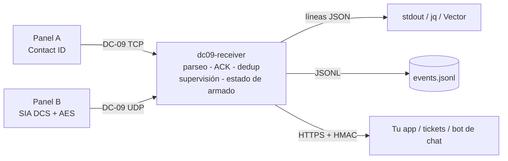

# dc09-receiver

**Receptor de alarmas ANSI/SIA DC-09, pequeño e independiente.** Apunta los
comunicadores IP o celulares de tus paneles de intrusión hacia él y recibe
eventos JSON limpios (por stdout, a un archivo o a un webhook firmado): robo,
incendio, pánico, armado y desarmado, fallas y el aviso de «panel sin
comunicación».

*English: [README.md](README.md)*

Casi todos los comunicadores IP (DSC/Tyco, Hikvision AX PRO, Paradox, Risco,
Ajax, Honeywell y muchos más) pueden reportar a una central receptora por
**SIA DC-09**, con eventos **Contact ID** (`ADM-CID`) o **SIA DCS** (`SIA-DCS`).
El software receptor comercial es caro y cerrado. Este proyecto les da a
integradores, centrales de monitoreo pequeñas, administradores de edificios y
usuarios de domótica un receptor libre y auditable que corre en un contenedor.



## Qué hace

- **Transporte DC-09**: verifica CRC-16 y largo, responde `ACK`, `NAK` o `DUH`, y
  atiende TCP (sesiones persistentes) y UDP en el mismo puerto.
- **Cifrado AES** (128/192/256, CBC) por abonado, con ACK cifrado y la ventana de
  tiempo que exige el estándar.
- Decodifica **Contact ID** y **SIA DCS** con descripciones en inglés o español,
  categorías (`alarm`, `trouble`, `supervisory`, `openclose`, `test`, `info`),
  partición, zona y usuario.
- Resuelve la **trampa clásica de Contact ID**: en los códigos 4xx el calificador
  significa *1 = desarmado, 3 = armado*, no «restauración».
- **Estado de armado** (`away`, `stay` o `disarmed`) deducido de los propios
  avisos del panel. DC-09 es de una sola vía: al panel no se le puede preguntar.
- **Supervisión**: emite el evento `SUPERVISION_LOST` cuando un abonado no manda
  nada durante `2 x intervalo + margen`, y `SUPERVISION_RESTORED` cuando vuelve.
- **Retransmisiones**: responde ACK a cada copia pero entrega solo la primera.
- Los keep-alive (`NULL` y las pruebas periódicas) alimentan la supervisión sin
  llenar la bandeja.
- **Ningún abonado desconocido se pierde en silencio**: se entrega con
  `account_known: false`, o se rechaza con `DUH` si así lo configuras.
- **Salidas**: líneas JSON por stdout, archivo JSONL, webhook con firma
  HMAC-SHA256 y reintentos, o una función de Python. Cada salida tiene su cola,
  así que un webhook lento nunca demora un ACK.
- Trae un **simulador de panel** (`dc09-receiver send`) y un **decodificador**
  (`dc09-receiver parse`) para la puesta en marcha.
- Python 3.11+ puro, **sin dependencias obligatorias** (`cryptography` solo para AES).

## Inicio rápido

```bash
pip install "dc09-receiver[aes]"
dc09-receiver serve                     # escucha en 0.0.0.0:9500 TCP+UDP; los eventos salen por stdout
```

En otra terminal, haz de panel:

```bash
dc09-receiver send --account 1234 --cid "1130 01 015"      # robo Contact ID, zona 15
dc09-receiver send --account 1234 --sia "Nri1/CL01" --udp  # armado SIA por el usuario 1, por UDP
dc09-receiver send --account 1234 --null                   # keep-alive
```

Con `language = "es"` las descripciones salen en español (`"description": "Robo"`).

## Docker

```bash
docker build -t dc09-receiver .
docker run --rm -p 9500:9500/tcp -p 9500:9500/udp dc09-receiver
```

Hay un ejemplo con archivo de configuración y un abonado cifrado en
[`examples/docker-compose.yml`](examples/docker-compose.yml).

## Configuración

Todo es opcional. Las claves posibles están en
[`examples/config.toml`](examples/config.toml). Los secretos pueden venir de
variables de entorno (`key_env`, `secret_env`).

```toml
[receiver]
port = 9500
language = "es"

[[accounts]]
account = "1234"           # 1 a 16 dígitos HEX, igual que en el panel
name = "Bodega de prueba"
supervision_minutes = 10
zones = { 1 = "Puerta principal", 15 = "Puerta trasera" }
```

## Programación del panel

| Parámetro | Valor |
|---|---|
| Protocolo | SIA DC-09 con Contact ID (ADM-CID) o SIA DCS |
| Servidor y puerto | IP pública o nombre del receptor, `9500` |
| Transporte | TCP (recomendado) o UDP |
| Cuenta | 1 a 16 caracteres **hexadecimales**. Un nombre como `bodega` genera tramas inválidas |
| Cifrado | opcional; la misma clave AES en el panel y en `[[accounts]]` |
| Prueba periódica | por ejemplo cada 10 min, con `supervision_minutes` igual |

Lecciones de campo:

- Si el panel conecta pero no llegan los armados, el comunicador está filtrando
  tipos de evento: habilita la apertura y el cierre en la misma pantalla del centro receptor.
- Si llegan eventos con `account_known: false`, alguien programó una cuenta que
  no diste de alta (casi siempre por un error de tipeo).
- Algunos paneles tardan más de un minuto en reportar el desarmado. No está
  trabado: hay que esperar el evento.
- Algunos paneles mandan `NULL` en vez del Contact ID 602 como latido. Los dos
  cuentan para la supervisión.

## Seguridad

Expón **solo** el puerto DC-09. Usa AES por abonado y, terminada la puesta en
marcha, `accept_unknown_accounts = false`. El DC-09 sin cifrar se puede falsificar
conociendo el número de cuenta. Para reportar vulnerabilidades, mira [SECURITY.md](SECURITY.md).

## Licencia

Apache 2.0 ([LICENSE](LICENSE), [NOTICE](NOTICE)). Copyright 2026 NS-Technologies / Hector Baquerizo.
Es una implementación independiente del estándar ANSI/SIA DC-09, sin afiliación con
SIA ni con ningún fabricante.
