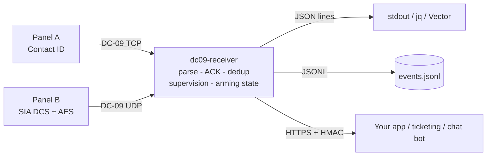

# dc09-receiver

[](https://github.com/hector2282/dc09-receiver/actions/workflows/ci.yml)
[](LICENSE)

**A small, standalone ANSI/SIA DC-09 alarm receiver.** Point your intrusion
panels' IP/cellular communicators at it and get clean JSON events (stdout, file
or a signed webhook) for burglary, fire, panic, arming/disarming, troubles and
"panel went silent" supervision.

*Español: [README.es.md](README.es.md)*

Most IP communicators (DSC/Tyco, Hikvision AX PRO, Paradox, Risco, Ajax,
Honeywell and many others) can report to a monitoring station over **SIA DC-09**,
carrying **Contact ID** (`ADM-CID`) or **SIA DCS** (`SIA-DCS`) events. Commercial
receiver software is expensive and closed; this project gives integrators,
small monitoring centers, building managers and home-automation users a free,
auditable receiver they can run in a container.



```
panel --(TCP/UDP 9500)--> dc09-receiver --ACK--> panel
                               |
                               +--> {"account":"1234","category":"alarm","description":"Burglary","zone":15,...}
```

## Features

- **DC-09 transport**: CRC-16 and length check, `ACK` / `NAK` / `DUH`, TCP
  (persistent sessions) and UDP on the same port.
- **AES encryption** (128/192/256, CBC) per account, including encrypted ACKs
  and the timestamp window check the standard requires.
- **Contact ID** and **SIA DCS** decoding with English and Spanish descriptions,
  categories (`alarm`, `trouble`, `supervisory`, `openclose`, `test`, `info`),
  partitions, zones and users.
- Handles the classic **Contact ID open/close trap**: for 4xx codes the
  qualifier means *1 = disarm, 3 = arm*, not "restore".
- **Arming state** tracking (`away` / `stay` / `disarmed`) from the panel's own
  open/close reports (DC-09 is one-way: you cannot poll a panel).
- **Supervision**: a `SUPERVISION_LOST` event when an account stops sending
  anything for `2 x interval + grace`, and `SUPERVISION_RESTORED` when it is back.
- **Retransmission dedup**: every copy is ACKed, only the first is delivered.
- Keep-alives (`NULL`, periodic tests) feed supervision without flooding your inbox.
- **Unknown accounts are never dropped silently**: they are delivered with
  `account_known: false` (or rejected with `DUH` if you prefer).
- **Sinks**: stdout JSON Lines, JSONL file, webhook with HMAC-SHA256 signature and
  retries, or a Python callback. Sinks are queued: a slow webhook never delays an ACK.
- Built-in **panel simulator** (`dc09-receiver send`) and **decoder**
  (`dc09-receiver parse`) for commissioning and debugging.
- Pure Python 3.11+, **zero required dependencies** (`cryptography` only for AES).

## Quick start

```bash
pip install "dc09-receiver[aes]"        # or: pip install . from a clone
dc09-receiver serve                     # listens on 0.0.0.0:9500 TCP+UDP, JSON on stdout
```

In another terminal, pretend to be a panel:

```bash
dc09-receiver send --account 1234 --cid "1130 01 015"      # Contact ID burglary, zone 15
dc09-receiver send --account 1234 --sia "Nri1/CL01" --udp  # SIA arm (closing) by user 1, over UDP
dc09-receiver send --account 1234 --null                   # keep-alive
```

The receiver prints:

```json
{"account": "1234", "protocol": "ADM-CID", "code": "1130", "category": "alarm",
 "description": "Burglary", "qualifier": "new", "partition": 1, "zone": 15,
 "user": null, "arming": null, "heartbeat": false, "sequence": "0001",
 "receiver": null, "line": "0", "panel_time": "2026-11-22T15:04:05+00:00",
 "received_at": "2026-11-22T15:04:05.120000+00:00", "remote_addr": "127.0.0.1",
 "transport": "tcp", "encrypted": false, "crc_ok": true, "account_known": false,
 "account_name": null, "zone_name": null, "raw": "...", "extra": {}}
```

Decode a captured frame without running a server:

```bash
dc09-receiver parse '\nBEB90027"ADM-CID"0001L0#1234[#1234|1130 01 015]\r'
```

## Docker

```bash
docker build -t dc09-receiver .
docker run --rm -p 9500:9500/tcp -p 9500:9500/udp dc09-receiver
```

With a config file and an encrypted account, see
[`examples/docker-compose.yml`](examples/docker-compose.yml):

```bash
cd examples && docker compose up --build
```

## Configuration

Everything is optional; see [`examples/config.toml`](examples/config.toml) for
all keys. Secrets can come from the environment (`key_env`, `secret_env`).

```toml
[receiver]
port = 9500
language = "en"            # or "es"

[[accounts]]
account = "1234"           # 1-16 HEX digits, exactly as programmed in the panel
name = "Demo warehouse"
supervision_minutes = 10
zones = { 1 = "Front door", 15 = "Back door" }

[[accounts]]
account = "5678"
key_env = "DC09_KEY_5678"  # AES key: hex, or "ascii:<16/24/32 chars>"

[[sinks]]
type = "webhook"
url = "https://alarms.example.com/dc09"
secret_env = "DC09_WEBHOOK_SECRET"
```

`DC09_CONFIG`, `DC09_HOST`, `DC09_PORT` and `DC09_LOG_LEVEL` environment
variables are also honored. Logs go to stderr; stdout carries only events.

### Webhook signature

Each POST carries `X-DC09-Signature: sha256=<hex HMAC of the raw body>`. A
verifying consumer is in [`examples/webhook_consumer.py`](examples/webhook_consumer.py).

## Programming the panel

On the communicator's "alarm receiving center" / "ARC" / "central station" page:

| Setting | Value |
|---|---|
| Protocol | SIA DC-09, with Contact ID (ADM-CID) or SIA DCS |
| Server / port | your receiver's public IP or hostname, `9500` |
| Transport | TCP (recommended) or UDP |
| Account | 1-16 **hex** characters. A name like `warehouse` produces invalid frames |
| Encryption | optional; same AES key in the panel and in `[[accounts]]` |
| Test / heartbeat | e.g. every 10 min, and set `supervision_minutes` to match |

Field notes that save hours:

- If the panel connects but you never see arm/disarm events, the communicator is
  filtering event types: enable open/close reporting on the same ARC page.
- If you see events with `account_known: false`, someone programmed an account
  you did not configure (often a typo).
- Some panels need over a minute to report a disarm. It is not stuck; wait for it.
- Some panels send `NULL` link tests instead of Contact ID 602: both count for supervision.

## Using it as a library

```python
from dc09_receiver import Config, Account, Receiver
from dc09_receiver.sinks import CallbackSink


async def on_event(e: dict): ...


cfg = Config(port=9500)
cfg.accounts["1234"] = Account("1234", supervision_minutes=10)
await Receiver(cfg, [CallbackSink(on_event)]).serve_forever()
```

Lower level: `parse_frame()`, `build_ack()`, `build_message()` and
`events_from_frame()` are public and documented.

## Security notes

- The DC-09 port must be reachable from the internet. Expose **only** that port,
  prefer AES per account and `accept_unknown_accounts = false` once commissioned.
- Unencrypted DC-09 can be spoofed by anyone who knows an account number. If
  you act on events (e.g. dispatch), use encryption.
- The receiver runs as a non-root user in the container and holds state only in
  memory. See [SECURITY.md](SECURITY.md) to report vulnerabilities.

## Status and scope

Version 0.1. The decoding logic comes from a receiver that has run in production
at a monitoring center with Hikvision AX PRO and DSC communicators (Contact ID
over TCP); this package is a clean-room rewrite of it for general use. The AES
path is covered by tests against the format described in the standard but has
not yet been validated against many real panels; reports are very welcome.

Not in scope (yet): persistent storage, a web UI, MQTT (use the webhook or the
callback sink), legacy SIA DC-03/DC-04/DC-05 over phone lines, SIA DC-09 2021 "R"
extended features.

### Related projects

- Home Assistant's SIA integration and the `pysiaalarm` library - great if you
  live inside Home Assistant.
- SIA's own DC-09 reference library (Java) and small single-protocol scripts.

dc09-receiver focuses on being a **standalone, container-friendly receiver**
with supervision, arming state and webhook delivery out of the box.

## Contributing

See [CONTRIBUTING.md](CONTRIBUTING.md). Captured frames from real panels (with
account numbers changed) are the most valuable contribution.

## License

Apache License 2.0, see [LICENSE](LICENSE) and [NOTICE](NOTICE).
Copyright 2026 NS-Technologies / Hector Baquerizo.

ANSI/SIA DC-09 is a standard of the Security Industry Association. This project
is an independent implementation and is not affiliated with SIA or any manufacturer.
